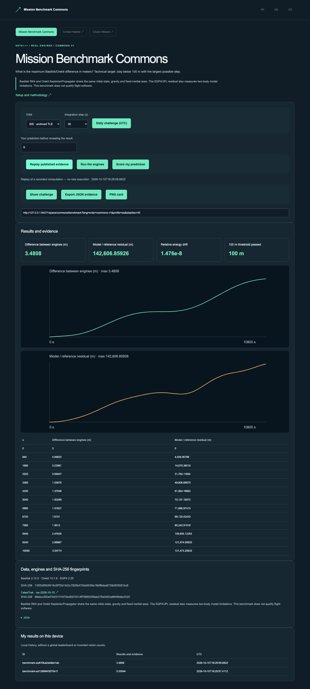

# Mission Benchmark Commons

[](https://github.com/gbesse/mission-benchmark-commons/actions) · [](LICENSE) · FR / EN / ES

[Français](README.md) · English · [Español](README.es.md)

Compare the accuracy of two orbital engines.

Basilisk RK4 and Orekit KeplerianPropagator share ISS/SGP4 or Moon/JPL DE440s initial states. Inspect numerical differences, energy drift and model residuals.



## Try in one minute

The demo uses actual computations archived and supplied in this standalone repository. Node.js 22+ is sufficient; no account, API key, parent repository or external service is needed for replay.

```sh
git clone https://github.com/gbesse/mission-benchmark-commons.git
cd mission-benchmark-commons
node bin/cli.js demo --locale=en
npm start
```

http://127.0.0.1:4323/?lang=en

Local FR/EN/ES UI, daily UTC challenge in a fixed catalog, scored prediction, reproducible parameter URL, JSON evidence and PNG card. History is local; no global leaderboard or invented traffic.

## Run the real engines

Python 3.11–3.13 and curl; Java 17+ on Linux, JDK downloaded on macOS ARM.

Basilisk 2.12.0 · Orekit 13.1.9 · SGP4 2.25 · SpiceyPy 8.2.0

```sh
npm run setup:engines
npm run test:engines
node bin/cli.js run --locale=en
```

The “Run” button and `run` command start installed engines; “Replay” does not rerun an engine. No synthetic fallback. Setup downloads only this project’s dependencies into Git-ignored `.local/space-runtime`. `SPACE_RUNTIME` may point to an existing runtime; `SPACE_LOCALE` sets setup language.

## Method, data and limitations

Basilisk RK4 and Orekit KeplerianPropagator share the same initial state, gravity and fixed inertial axes. The SGP4/JPL residual also measures two-body model limitations. This benchmark does not qualify flight software.

Versions, parameters, hashes and notices are included. Large H5/SPK files and binaries are not redistributed; their sources and SHA-256 are pinned. External dependencies and data retain their respective terms.

Independent MIT software project, without affiliation with NASA/JPL, ESA or cited providers. No fabrication machine software or API is required. Code extracted from Frontier Lab and adapted to a standalone repository; provenance in `upstream.json`. User data is not translated. CLI exports never overwrite files.

## Verify and contribute

```sh
npm ci
npm test
npx playwright install chromium
npm run test:browser
npm run format:check
```

`npm run build` exports `output/site` for static hosting at a domain root. This edition replays published cases, without exposing engines or local APIs.

[Mission Benchmark Commons](https://github.com/gbesse/mission-benchmark-commons) · [Contact Market](https://github.com/gbesse/contact-market) · [Citizen Mission](https://github.com/gbesse/citizen-mission)
