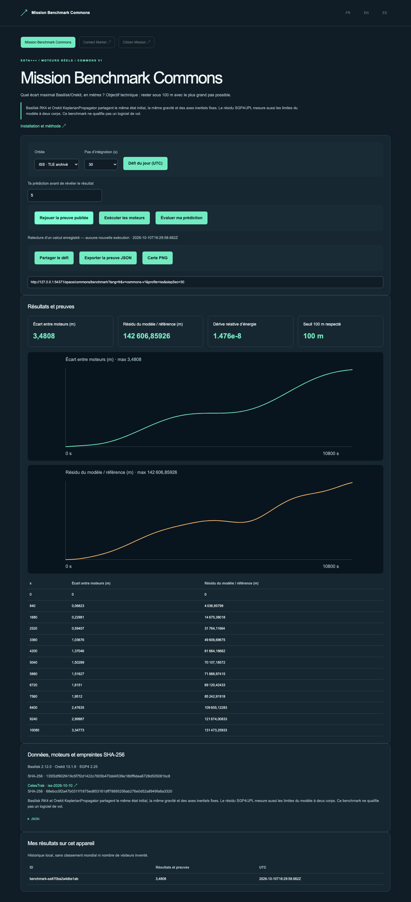

# Mission Benchmark Commons

[](https://github.com/gbesse/mission-benchmark-commons/actions) · [](LICENSE) · FR / EN / ES

Français · [English](README.en.md) · [Español](README.es.md)

Comparer la précision de deux moteurs orbitaux.

Basilisk RK4 et Orekit KeplerianPropagator partagent les états initiaux ISS/SGP4 ou Lune/JPL DE440s. Inspecter les écarts numériques, la dérive d’énergie et les résidus du modèle.



## Essayer en une minute

La démo utilise des calculs réellement exécutés et archivés, fournis dans ce dépôt autonome. Node.js 22+ suffit ; aucun compte, clé API, dépôt parent ou service externe n’est nécessaire pour la relecture.

```sh
git clone https://github.com/gbesse/mission-benchmark-commons.git
cd mission-benchmark-commons
node bin/cli.js demo --locale=fr
npm start
```

http://127.0.0.1:4323/?lang=fr

Interface locale FR/EN/ES, défi quotidien UTC dans un catalogue figé, prédiction scorée, URL de paramètres reproductible, preuve JSON et carte PNG. L’historique est local ; aucun classement mondial ni trafic inventé.

## Exécuter les vrais moteurs

Python 3.11–3.13 et curl ; Java 17+ sur Linux, JDK téléchargé sur macOS ARM.

Basilisk 2.12.0 · Orekit 13.1.9 · SGP4 2.25 · SpiceyPy 8.2.0

```sh
npm run setup:engines
npm run test:engines
node bin/cli.js run --locale=fr
```

Le bouton « Exécuter » et la commande `run` lancent les moteurs installés ; « Rejouer » ne relance aucun moteur. Aucun résultat de secours synthétique. L’installation télécharge seulement les dépendances de ce projet, dans `.local/space-runtime`, ignoré par Git. `SPACE_RUNTIME` peut désigner un runtime déjà installé ; `SPACE_LOCALE` choisit la langue du script.

## Méthode, données et limites

Basilisk RK4 et Orekit KeplerianPropagator partagent le même état initial, la même gravité et des axes inertiels fixes. Le résidu SGP4/JPL mesure aussi les limites du modèle à deux corps. Ce benchmark ne qualifie pas un logiciel de vol.

Les versions, paramètres, empreintes et notices sont inclus. Les grands fichiers H5/SPK et les binaires ne sont pas redistribués ; leurs sources et SHA-256 sont épinglés. Les dépendances et données externes conservent leurs conditions respectives.

Projet logiciel indépendant sous licence MIT, sans affiliation NASA/JPL, ESA ou fournisseurs cités. Aucun logiciel ni API de machine de fabrication requis. Code extrait de Frontier Lab, adapté à un dépôt autonome ; provenance dans `upstream.json`. Les données utilisateur ne sont pas traduites. Les exports CLI n’écrasent pas les fichiers.

## Vérifier et contribuer

```sh
npm ci
npm test
npx playwright install chromium
npm run test:browser
npm run format:check
```

`npm run build` exporte `output/site` pour un hébergement statique à la racine d’un domaine. Cette édition rejoue les cas publiés, sans moteur ni API locale exposée.

[Mission Benchmark Commons](https://github.com/gbesse/mission-benchmark-commons) · [Contact Market](https://github.com/gbesse/contact-market) · [Citizen Mission](https://github.com/gbesse/citizen-mission)
